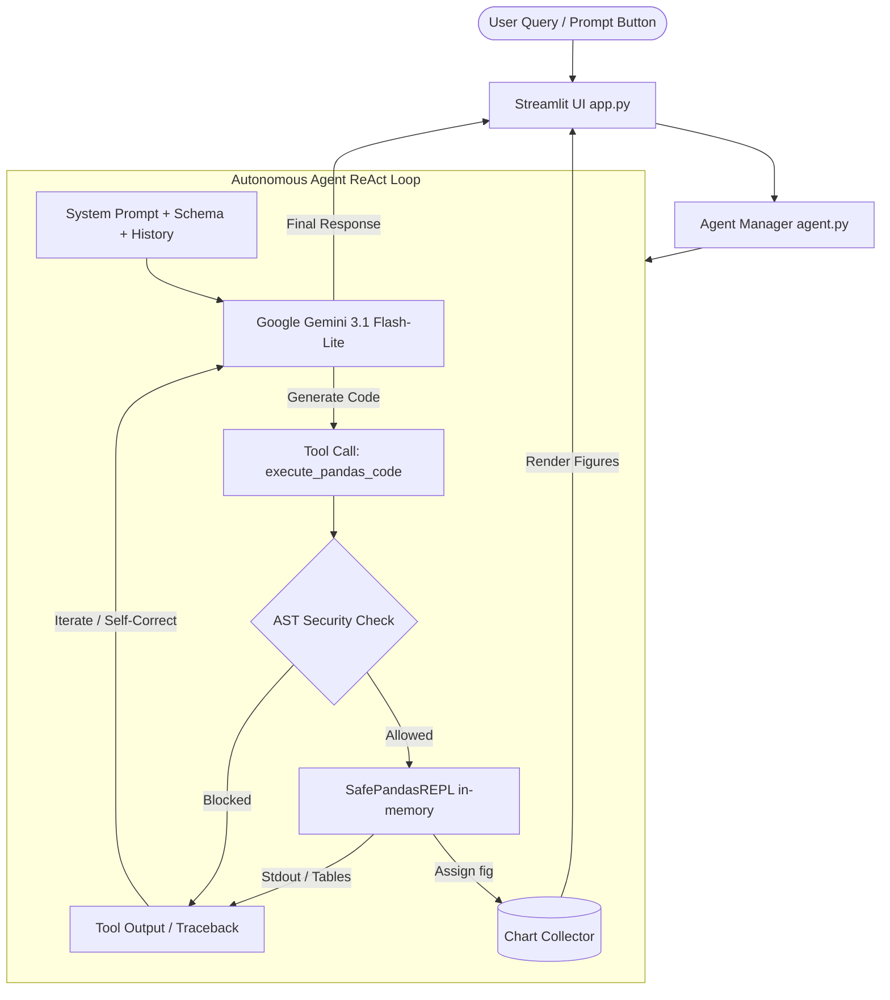

# Autonomous Data Analysis Agent

An autonomous data analysis assistant built with **Streamlit**, **LangChain**, and **Google Gemini (`gemini-3.1-flash-lite`)**. The agent reasons over uploaded CSV datasets, writes and executes Python/Pandas code in an isolated sandbox, and automatically produces interactive Plotly visualizations and executive summaries.

---

## Features

- **CSV Ingestion & Schema Profiling**: Instant dataset inspection displaying row counts, attribute types, memory footprint, and data completeness metrics.
- **Agentic Reasoning (ReAct Loop)**: Autonomous multi-step analysis powered by LangChain's tool-calling architecture and deterministic Gemini reasoning (`temperature=0.0`).
- **Automated Interactive Charts**: Dynamically generates Plotly figures for rankings, distributions, correlations, and trends.
- **Execution Transparency**: Collapsible view showing exact Python/Pandas code written by the agent and raw tool output.
- **Security Guardrails**: AST-based code validation blocking file I/O, OS commands (`os`, `sys`, `subprocess`), and network requests.
- **One-Click Report Export**: Download the entire session and findings as a structured Markdown (`.md`) report.

---

## Architecture Flow



---

## Project Structure

```text
├── app.py                # Streamlit interface, chat loop, and session state
├── agent.py              # LangChain agent executor and prompt definitions
├── utils.py              # Sandbox REPL, AST guardrail, profiler, and chart collector
├── sample_sales_data.csv # Pre-bundled 600-row e-commerce dataset for demo testing
├── requirements.txt      # Project dependencies
├── .env.example          # Environment variable template
└── .gitignore            # Git exclusion rules
```

---

## Quickstart

### 1. Clone & Navigate
```bash
git clone <your-repo-url>
cd autonomous-data-analysis-agent
```

### 2. Install Dependencies
```bash
pip install -r requirements.txt
```

### 3. Configure API Key
Create a `.env` file in the project root:
```bash
copy .env.example .env
```
Add your Google Gemini API key:
```env
GEMINI_API_KEY=your_gemini_api_key_here
```

### 4. Run Application
```bash
streamlit run app.py
```

The application will start at `http://localhost:8501`.

---

## Security

Code executed by the agent is subject to static AST inspection before execution:
- Prohibits system-level imports: `os`, `sys`, `subprocess`, `shutil`, `pathlib`, `socket`.
- Restricts built-in file and evaluation operations: `open`, `eval`, `exec`, `compile`, `__import__`.
- Restricts reflection and dunder attribute traversals (`__globals__`, `__subclasses__`).

---

## License

MIT License. Free for open-source and commercial use.
